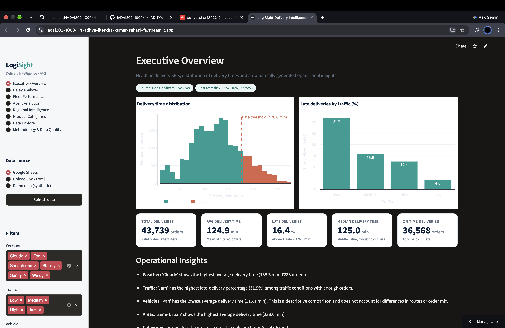
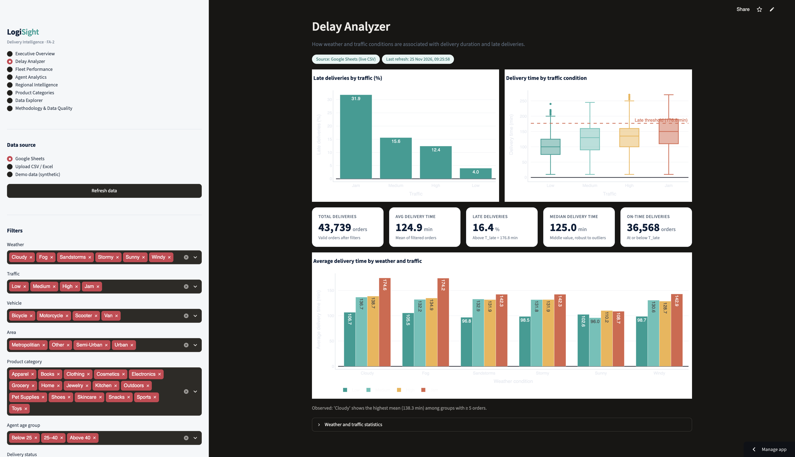
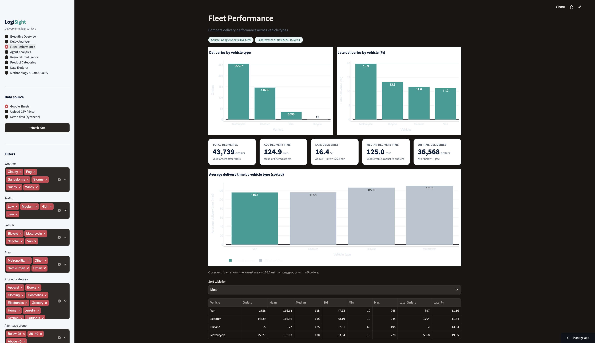
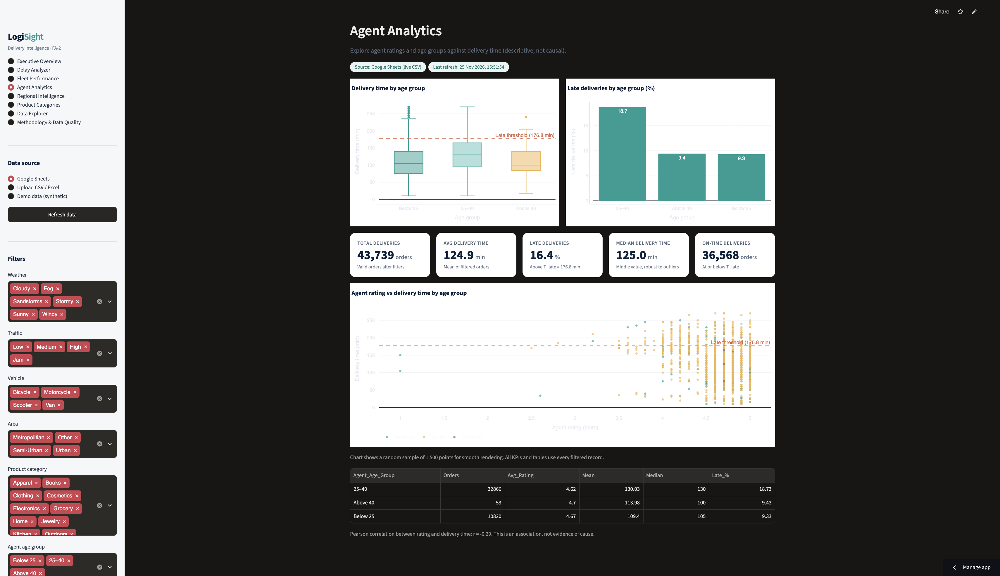
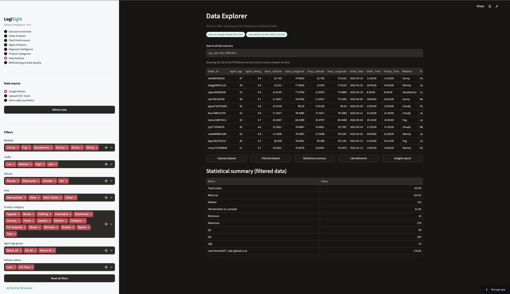

# LogiSight — Delivery Intelligence Dashboard

### FA-2 | Mathematics for AI-II

**An Interactive Last-Mile Delivery Analytics and Statistical Intelligence Platform**

LogiSight is a Python-based interactive analytics dashboard designed to explore last-mile delivery performance using statistical analysis, data preprocessing and interactive visualisations. 

Developed as part of **Formative Assessment 2 (FA-2) for Mathematics for AI-II**, this project transforms the analytical planning from FA-1 into a functional multi-page web application using Streamlit.

The dashboard enables users to investigate delivery delays, compare vehicle performance, examine delivery-agent characteristics, identify regional patterns and explore product-category differences through data-driven insights.

**Live Application:** [Open LogiSight Dashboard](https://iadai202-1000414-aditya-jitendra-kumar-sahani-fa.streamlit.app/)

**GitHub Repository:** [View Source Code](https://github.com/adityasahani392217/IADAI202-1000414-ADITYA-JITENDRA-KUMAR-SAHANI-FA)

---

## 1. Project Overview

Last-mile delivery performance is influenced by several operational factors, including traffic conditions, weather, vehicle types, delivery locations and agent-related characteristics.

LogiSight provides an analytical environment to investigate these factors using a structured data-processing pipeline.

The application converts raw delivery records into cleaned, validated and analysable data before presenting statistical summaries and interactive visualisations.

### Project Objectives

- Analyse delivery-time distributions and identify unusually long deliveries.
- Investigate relationships between weather, traffic and delivery performance.
- Compare delivery efficiency across vehicle categories.
- Explore delivery-agent ratings and age groups.
- Identify regional delivery bottlenecks.
- Compare delivery times across product categories.
- Apply mathematical and statistical methods to real-world operational data.
- Present analytical findings through an interactive dashboard.

## 2. Technology Stack

| Technology | Purpose |
|---|---|
| Python | Core programming language |
| Pandas | Data manipulation and analysis |
| NumPy | Numerical computations |
| Streamlit | Interactive web application |
| Plotly | Interactive charts and visualisations |
| OpenPyXL | Excel file processing |
| GitHub | Source-code management |
| Streamlit Community Cloud | Application deployment |

## 3. Dashboard Features

LogiSight contains eight analytical sections.

### 3.1 Executive Overview

Provides a consolidated view of delivery performance through:

- Total valid deliveries.
- Average delivery time.
- Median delivery time.
- Late-delivery percentage.
- On-time delivery count.
- Delivery-time distribution.
- Late deliveries by traffic condition.
- Automatically generated operational insights.



### 3.2 Delay Analyzer

Investigates how weather and traffic conditions are associated with delivery duration.

Features include:

- Delivery-time comparisons.
- Weather and traffic analysis.
- Late-delivery percentages.
- Box plots and comparative charts.
- Group-level statistical summaries.



### 3.3 Fleet Performance

Evaluates delivery performance across different vehicle types.

Features include:

- Average delivery time by vehicle.
- Median delivery time.
- Delivery volume comparisons.
- Late-delivery percentages.
- Vehicle performance rankings.



### 3.4 Agent Analytics

Examines delivery-agent characteristics and their association with delivery performance.

Features include:

- Agent rating versus delivery time.
- Delivery-time comparisons by age group.
- Late-delivery percentages by age group.
- Average agent ratings.
- Pearson correlation analysis.

These findings are descriptive and do not establish causation.



### 3.5 Regional Intelligence

Identifies geographical variations in delivery performance.

Features include:

- Average delivery time by area.
- Late-delivery percentages by area.
- Area and traffic heatmap.
- Delivery-volume comparisons.
- Regional performance tables.


### 3.6 Product Categories

Investigates delivery-time differences across product categories.

Features include:

- Category-wise average delivery time.
- Median delivery-time comparisons.
- Delivery-time distributions.
- Category performance tables.


### 3.7 Data Explorer

Provides access to the cleaned and filtered dataset.

Features include:

- Search across text columns.
- Interactive data tables.
- Global filter integration.
- Cleaned dataset export.
- Filtered dataset export.
- Statistical summary export.
- Late-delivery export.
- Analytical insights report export.



### 3.8 Methodology & Data Quality

Documents the mathematical and data-processing methodology.

Features include:

- Dataset validation.
- Missing-value analysis.
- Duplicate detection.
- Data-cleaning reports.
- Data-type inspection.
- Statistical formulas.
- Mathematical assumptions.
- Methodological limitations.


## 4. Dataset and Data Sources

The application supports three data-loading methods.

### 4.1 Google Sheets

Loads data using a CSV export URL configured in:

`utils/data_loader.py`

The Google Sheet must be accessible through an appropriate link-sharing permission.

### 4.2 CSV and Excel Upload

Users can upload their own delivery datasets in:

- `.csv`
- `.xlsx`

The application automatically attempts to match column names. If required columns cannot be identified, users can manually map them through the sidebar.

### 4.3 Synthetic Demonstration Dataset

The application can generate synthetic demonstration records.

> **Important:** Synthetic data is generated for demonstration and testing purposes. It must not be interpreted as actual delivery records or used to support claims about real delivery operations.

### Expected Dataset Variables

| Variable | Description |
|---|---|
| Order_ID | Unique delivery/order identifier (optional) |
| Delivery_Time | Delivery duration in minutes |
| Weather | Weather condition |
| Traffic | Traffic condition |
| Vehicle | Delivery vehicle type |
| Agent_Rating | Delivery-agent rating |
| Agent_Age | Age of the delivery agent |
| Area | Delivery area |
| Category | Product category |

The eight analytical variables are required for the dashboard.

## 5. Data Processing and Cleaning

The application follows a structured preprocessing pipeline.

1. **Data ingestion:** Load records from Google Sheets, CSV, Excel or synthetic data.
2. **Column identification:** Automatically match expected variables or allow manual mapping.
3. **Data validation:** Check missing values, data types and invalid numerical values.
4. **Duplicate handling:** Remove repeated records using Order_ID when available.
5. **Missing-value treatment:** Use median imputation for applicable numerical variables and mode imputation for categorical variables.
6. **Delivery-time validation:** Exclude records with missing, non-numeric or non-positive delivery times.
7. **Feature engineering:** Create agent age groups and late-delivery classifications.
8. **Statistical analysis:** Calculate summary statistics and group-level comparisons.
9. **Visualisation:** Generate interactive charts and operational insights.

Cleaning is performed on a working copy, preserving the original loaded dataset.

### Data Validation Rules

- Delivery time must be greater than zero.
- Agent rating must be between 0 and 5.
- Agent age must be between 1 and 100.
- Invalid delivery-time records are excluded rather than imputed.

### Agent Age Groups

| Group | Condition |
|---|---|
| Below 25 | Age < 25 |
| 25–40 | 25 ≤ Age ≤ 40 |
| Above 40 | Age > 40 |

Missing agent ages are median-imputed before grouping.

## 6. Mathematical and Statistical Methodology

The project uses descriptive statistics to evaluate delivery performance.

### 6.1 Arithmetic Mean

The arithmetic mean represents the average delivery time.

$$
\mu=\frac{1}{n}\sum_{i=1}^{n}t_i
$$

Where:

- $\mu$ = Mean delivery time
- $n$ = Number of valid delivery records
- $t_i$ = Delivery time of the $i$-th order

### 6.2 Sample Standard Deviation

Sample standard deviation measures the spread of delivery times around the mean.

$$
\sigma=\sqrt{\frac{\sum_{i=1}^{n}(t_i-\mu)^2}{n-1}}
$$

The application uses the sample standard deviation convention, with $n-1$ in the denominator.

### 6.3 Project-Defined Late-Delivery Threshold

The project defines a statistical threshold:

$$
T_{\text{late}}=\mu+\sigma
$$

A delivery is classified as late when:

$$
t_i>T_{\text{late}}
$$

Deliveries at or below the threshold are classified as on-time for this project's analysis.

> **Important methodological distinction:** This is a project-defined statistical classification, not an official company service-level agreement (SLA).

The threshold is calculated once using the full cleaned dataset. Therefore, changing dashboard filters does not change the underlying definition of a late delivery.

### 6.4 Late-Delivery Percentage

$$
\text{Late \%}=
\frac{\text{Number of late deliveries}}
{\text{Total valid deliveries}}
\times100
$$

### 6.5 Median

The median represents the middle delivery-time observation after arranging valid delivery times in ascending order.

It provides a measure of central tendency that is less sensitive to extreme values than the mean.

### 6.6 Interquartile Range

$$
IQR=Q_3-Q_1
$$

The interquartile range measures the spread of the middle 50% of delivery times.

### 6.7 Pearson Correlation

Pearson's correlation coefficient is used to examine the linear association between agent ratings and delivery times.

$$
r=\frac{\operatorname{Cov}(X,Y)}{s_Xs_Y}
$$

The coefficient ranges from -1 to +1.

Correlation indicates association and must not be interpreted as proof of causation.

## 7. Global Dashboard Filters

The sidebar provides seven interactive filters:

- Weather
- Traffic
- Vehicle
- Area
- Product category
- Agent age group
- Delivery status

All analytical pages respond to the selected filters.

The late-delivery threshold remains fixed using the full cleaned dataset, ensuring consistent classification across different filter selections.

## 8. Project Architecture

The application uses a modular Python structure.

```text
IADAI202-1000414-ADITYA-JITENDRA-KUMAR-SAHANI-FA/
│
├── app.py
│
├── requirements.txt
│
├── README.md
│
├── utils/
│   ├── __init__.py
│   ├── data_loader.py
│   ├── preprocessing.py
│   ├── calculations.py
│   ├── charts.py
│   └── insights.py
│
└── tests/
    └── test_core.py
```

### Module Responsibilities

| File | Responsibility |
|---|---|
| `app.py` | Main Streamlit application and dashboard navigation |
| `data_loader.py` | Data loading and synthetic dataset generation |
| `preprocessing.py` | Data cleaning, validation and feature engineering |
| `calculations.py` | Statistical calculations and summary tables |
| `charts.py` | Plotly visualisations |
| `insights.py` | Automated analytical insights |
| `test_core.py` | Core functionality and edge-case tests |
| `requirements.txt` | Project dependencies |

## 9. Installation and Local Execution

### Prerequisites

- Python 3.10 or later recommended.
- pip package manager.
- Git (optional, for cloning the repository).

### Step 1: Clone the Repository

```bash
git clone https://github.com/adityasahani392217/IADAI202-1000414-ADITYA-JITENDRA-KUMAR-SAHANI-FA.git
```

### Step 2: Navigate into the Project

```bash
cd IADAI202-1000414-ADITYA-JITENDRA-KUMAR-SAHANI-FA
```

### Step 3: Create a Virtual Environment

```bash
python -m venv .venv
```

Activate it:

**Windows**

```bash
.venv\Scripts\activate
```

**macOS / Linux**

```bash
source .venv/bin/activate
```

### Step 4: Install Dependencies

```bash
pip install -r requirements.txt
```

### Step 5: Launch the Application

```bash
streamlit run app.py
```

Streamlit will provide a local URL, usually:

```text
http://localhost:8501
```

Open this URL in your browser.

## 10. Testing

The project includes a core test script for checking data processing and statistical functionality.

Run:

```bash
python tests/test_core.py
```

The existing test documentation covers:

- Data cleaning.
- Statistical calculations.
- Uploaded dataset handling.
- Edge cases.

Testing dependencies include Pandas, NumPy and OpenPyXL.

## 11. Deployment

The application is deployed using Streamlit Community Cloud.

### Deployment Procedure

1. Push the project files to GitHub.
2. Open [Streamlit Community Cloud](https://share.streamlit.io/).
3. Sign in using GitHub.
4. Select the LogiSight repository.
5. Select the deployment branch.
6. Set the main application file to `app.py`.
7. Deploy the application.

### Live Deployment

[Launch LogiSight Delivery Intelligence](https://iadai202-1000414-aditya-jitendra-kumar-sahani-fa.streamlit.app/)

## 12. Methodological Assumptions and Limitations

The results should be interpreted within the scope of the available dataset and statistical methods.

1. **Descriptive analysis:** The dashboard identifies statistical associations, not causal relationships.
2. **Project-defined classification:** The mean-plus-standard-deviation threshold is not an official delivery SLA.
3. **Missing values:** Imputation may affect the distribution and variability of the data.
4. **Group sizes:** Small groups can produce unstable statistical summaries. Automated insights use minimum group-size requirements.
5. **Visualisation sampling:** Agent scatter plots may display a random sample of 1,500 observations for rendering performance. KPIs and tables continue to use all filtered records.
6. **Limited explanatory variables:** The available dataset does not include all possible factors, such as delivery distance or time-of-day information.
7. **Potential confounding:** Observed differences between groups may be influenced by variables not included in the dataset.

## 13. FA-1 to FA-2 Implementation

FA-2 develops the analytical planning established during FA-1 into a functional application.

| FA-1 Planned Component | FA-2 Implementation |
|---|---|
| Delivery delay analysis | Delay Analyzer |
| Vehicle comparison | Fleet Performance |
| Agent performance | Agent Analytics |
| Regional bottleneck identification | Regional Intelligence |
| Product-category analysis | Product Categories |
| Interactive filtering | Global sidebar filters |
| Data-processing workflow | Modular preprocessing and calculation pipeline |
| Analytical reporting | Executive Overview and Data Explorer |

The implementation demonstrates how mathematical concepts and data-processing techniques can be integrated into a practical analytical application.

## 14. Future Improvements

Potential extensions include:

- Incorporating delivery distance and time-of-day variables.
- Adding time-series delivery analysis.
- Comparing delivery performance across different periods.
- Introducing predictive models for delivery-time estimation.
- Developing more advanced anomaly-detection methods.
- Adding additional validation and automated test coverage.

These are potential future extensions and are not claimed as completed features.

## 15. Academic Project Information

**Project:** LogiSight — Delivery Intelligence Dashboard  
**Assessment:** Formative Assessment 2 (FA-2)  
**Course:** Mathematics for AI-II  
**Student:** Aditya Jitendra Kumar Sahani  
**Student ID:** 1000414  
**Repository:** [GitHub — LogiSight FA-2](https://github.com/adityasahani392217/IADAI202-1000414-ADITYA-JITENDRA-KUMAR-SAHANI-FA)  
**Live Application:** [Streamlit Dashboard](https://iadai202-1000414-aditya-jitendra-kumar-sahani-fa.streamlit.app/)

---

*LogiSight — Turning delivery data into meaningful statistical insights.*

**Developed using Python, Pandas, NumPy, Streamlit and Plotly.**
